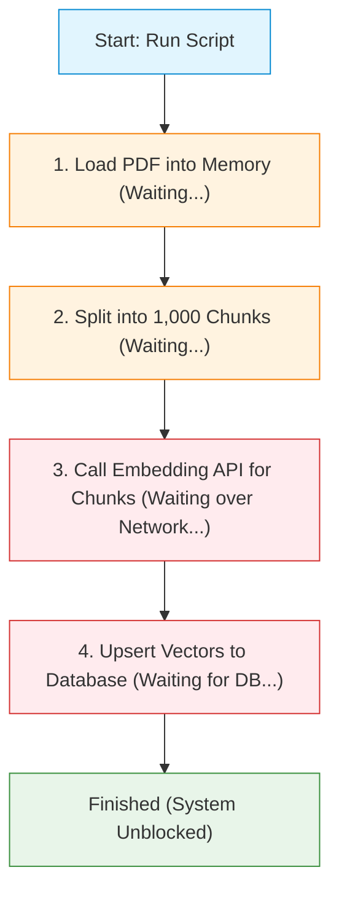
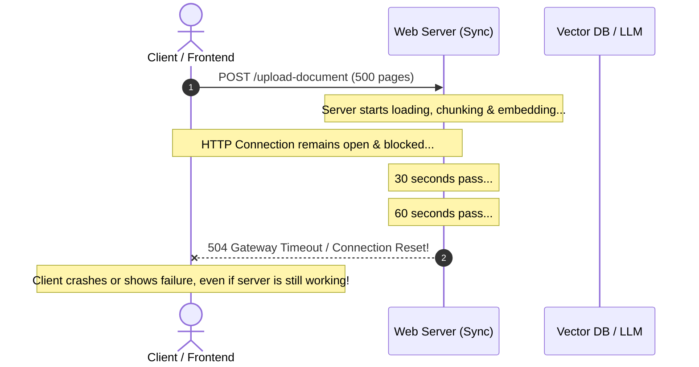
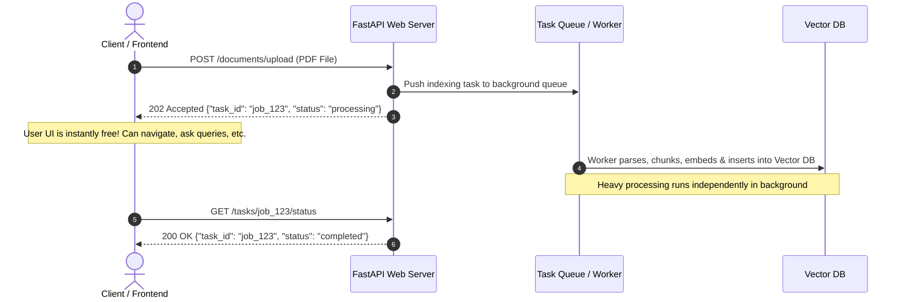
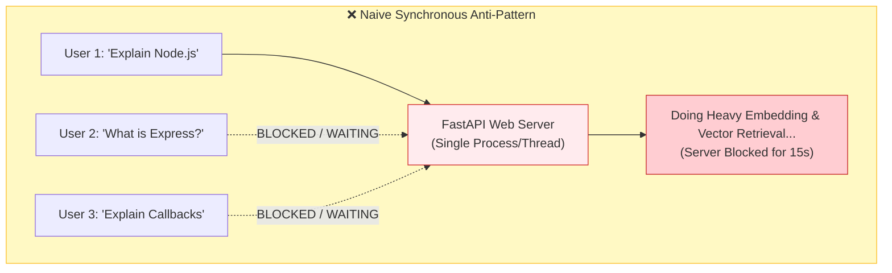
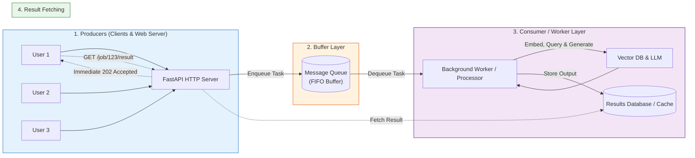
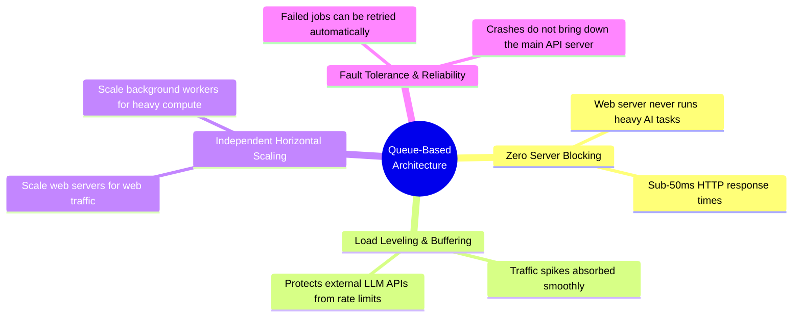
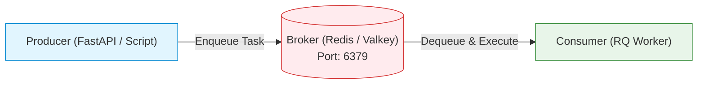
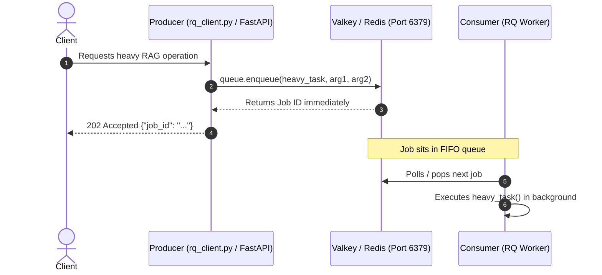

# Module 22: Scalable RAG with Async Queues & Distributed Workers

---

# 1. Sync vs. Async in RAG Architectures

## 1. Where We Stand: The Working Prototype

In the previous module, we built a fully functional end-to-end RAG (Retrieval-Augmented Generation) pipeline:
1. **Document Loading:** Ingesting PDF documents (e.g., using `PyPDFLoader`).
2. **Text Chunking:** Breaking long texts into overlapping passages (`RecursiveCharacterTextSplitter`).
3. **Vector Embeddings:** Generating dense vector representations via embedding models.
4. **Vector Storage:** Storing and indexing vectors in a vector database (e.g., Qdrant).
5. **Retrieval & Generation:** Searching top-$k$ relevant chunks and augmenting LLM prompts for grounded answers.

In software engineering, there is an old adage:
> *"If it works, don't touch it."*

While our standalone scripts (`rag.py`, `chat.py`) work reliably for local experimentation and single-document demos, **they are not how production systems are built in real-world enterprises**.

---

## 2. The Core Problem: Synchronous (Blocking) Execution

Our previous implementation is strictly **synchronous**.

### What Does Synchronous Mean?
In a synchronous flow, tasks execute sequentially one after another on a single thread. The program **stops and waits (blocks)** at every step until that specific step finishes before moving to the next line of code.



### Why Synchronous Indexing Fails in Production

Even for a single PDF of 50 pages, synchronous indexing takes **15 to 45 seconds**:
- Reading the binary PDF and extracting text involves disk I/O.
- Text splitting consumes CPU cycles.
- Generating vector embeddings requires multiple network roundtrips to an external API (OpenAI, Gemini).
- Storing vectors requires network calls to your vector database.

While this script is running:
- **The execution process is completely frozen.**
- **The CPU/thread cannot do any other work.**
- **The user or calling client is trapped waiting for the entire process to complete.**

---

## 3. Real-World Production Failure Scenarios

Imagine moving this synchronous script directly into an enterprise backend application:

### Scenario 1: The Multi-Document Deluge
- Suppose an enterprise uploads **1,000 PDF documents**, each containing **200 to 500 pages**.
- A synchronous process would take **several hours or even days** to finish sequentially.
- If document #742 encounters a network glitch or an API rate-limit error, the entire synchronous loop crashes, leaving the system in an inconsistent, half-indexed state.

### Scenario 2: The Web API / HTTP Timeout Disaster
In a production web application, users upload documents through a web browser or mobile app:



- Web servers, proxies (Nginx), and browsers enforce strict request timeouts (typically **30 to 60 seconds**).
- If an indexing operation takes 90 seconds, the browser will receive an **HTTP 504 Gateway Timeout**.
- From the user's perspective, the application is broken, frozen, or dead.

### Scenario 3: Server Resource Starvation
- If 10 users upload documents at the same time, a synchronous server quickly exhausts its thread/worker pool.
- Any subsequent user trying to browse the website or chat with the bot is blocked from connecting.

---

## 4. The Solution: Asynchronous Architecture & Background Processing

To make RAG production-grade, we must decouple the **User Request** from the **Heavy Background Work**.

### The Asynchronous Paradigm
Instead of forcing the client to wait while the server reads, chunks, and embeds documents:
1. **Immediate Acknowledgment:** The server accepts the upload, creates a job record, and immediately replies with `HTTP 202 Accepted` along with a unique `task_id` (in less than **50 milliseconds**).
2. **Background Delegation:** The heavy document processing is handed over to an asynchronous task runner or distributed background worker.
3. **Non-Blocking Client:** The user is free to continue chatting, browsing, or uploading other files without delay.
4. **Status Polling / Notifications:** The client can check the indexing status (`QUEUED` $\to$ `PROCESSING` $\to$ `COMPLETED`) via a status endpoint or WebSocket.



---

## 5. Architectural Comparison: Sync vs. Async RAG

| Architectural Dimension | Synchronous Approach (Module 21) | Asynchronous Approach (Module 22) |
| :--- | :--- | :--- |
| **Execution Model** | Sequential; blocking on a single thread. | Concurrent / Event-driven; non-blocking background workers. |
| **User Experience (UX)** | Frozen UI; user waits 30–120s per document. | Instant response (<100ms); background progress tracking. |
| **HTTP Request Lifecycle** | Long-lived connection prone to `504 Timeout`. | Short-lived request with `HTTP 202 Accepted` + polling. |
| **Throughput & Scalability** | Low; 1 heavy job blocks the entire server. | High; workers scale independently to handle spikes. |
| **Error Handling & Retries** | Script crashes mid-way; state lost. | Queue-level retries, dead-letter queues, and failure isolation. |
| **Production Readiness** | Suitable only for local scripts and rapid prototyping. | Standard enterprise architectural pattern. |

---

## 6. What We Will Build in Module 22

In this module, we transition our RAG knowledge from simple local scripts to **enterprise-grade, production-ready distributed architectures**:

* **FastAPI Backend:** Building high-speed, asynchronous RESTful APIs for document management and querying.
* **Async Python (`async` / `await`):** Mastering non-blocking I/O in Python to handle high concurrency.
* **Background Task Queues:** Offloading heavy vector indexing to asynchronous worker pipelines.
* **State & Job Tracking:** Exposing task status endpoints so client applications can monitor indexing progress in real time.
* **Distributed Scalability:** Structuring the codebase so vector indexing workers can scale horizontally across multiple instances.

---

## Summary Key Takeaways

1. **Working $\neq$ Production-Ready:** A local Python script that works sequentially is great for learning, but fails in production due to latency, timeouts, and resource blocking.
2. **Synchronous is Blocking:** In synchronous RAG, every page load, chunk split, embedding API call, and vector DB insertion forces the entire process to stop and wait.
3. **Asynchronous Decouples the Load:** By accepting the file immediately and offloading the heavy embedding/indexing pipeline to background workers, the system remains responsive, scalable, and resilient to failure.


---

# 2. Introduction to Queues: System Design for Async Setup

## 1. Why System Design Matters in Agentic AI & RAG

A common misconception among beginner AI engineers is:
> *"I know how to write prompts, call LLMs, and write LangChain scripts, so I am ready for production."*

In reality:
- **Prompting & LLM Calls = 20% of the Work.**
- **System Design & Distributed Scalability = 80% of the Work.**

When thousands of users simultaneously ask questions or upload files to your RAG application, a poorly designed architecture will freeze, crash, or run out of memory. To build production-grade AI systems, we must apply **foundational System Design principles**, specifically **Queue-based architectures**.

---

## 2. What is a Queue? (The Core Data Structure)

A **Queue** is a linear data structure that operates strictly on the **FIFO (First In, First Out)** principle:
- **Enqueue (Push):** New tasks or jobs are added to the back (tail) of the queue.
- **Dequeue (Pop):** Tasks are processed and removed from the front (head) of the queue in the exact order they arrived.


Just like people standing in line at a movie ticket counter: the first person to arrive is the first person served.

---

## 3. The Naive Approach vs. The Queue-Based Architecture

### A. The Naive Anti-Pattern (Doing Everything Inside the HTTP Server)

In a naive setup, the HTTP web server (e.g., FastAPI) receives the request and executes the heavy RAG retrieval or indexing directly inside the endpoint handler:



#### Why This Fails:
1. **Server Thread Exhaustion:** While the server spends 10–20 seconds embedding text and querying the vector database for User 1, the server is completely tied up.
2. **Cascading Delays:** User 2 and User 3 are stuck waiting, even if their queries are small.
3. **Terrible User Experience:** High latency, frequent connection timeouts, and zero fault isolation.

---

### B. The Production Architecture: Producer-Consumer with a Queue

To solve this, we decouple the system into distinct architectural roles:
1. **The Producer (FastAPI Web Server):** Listens to incoming user traffic, packages the work as a "job", pushes it into the queue, and responds immediately with an acknowledgment.
2. **The Buffer (The Queue):** Holds waiting jobs in memory or persistent storage (e.g., Redis, RabbitMQ, Celery, or in-memory queues).
3. **The Consumer / Processor / Worker:** A dedicated background worker process that pulls jobs off the queue one by one, executes the heavy retrieval or indexing, and saves the final result.
4. **The Results Store (Database / Cache):** Stores the finished answers so the user can retrieve them.



---

## 4. Step-by-Step Lifecycle of an Asynchronous Queue Request

| Step | Component | Action | Latency |
| :--- | :--- | :--- | :--- |
| **1. Submit** | User $\to$ FastAPI | User submits a question or document to the API. | ~10 ms |
| **2. Enqueue** | FastAPI $\to$ Queue | FastAPI creates a `job_id`, pushes the payload into the queue. | ~5 ms |
| **3. Acknowledge** | FastAPI $\to$ User | Server immediately returns `{"job_id": "abc-123", "status": "queued"}`. | < 50 ms total |
| **4. Dequeue** | Worker $\leftarrow$ Queue | Background worker pulls the next job from the queue. | Asynchronous |
| **5. Process** | Worker $\to$ LLM/Vector DB | Worker performs embedding, similarity search, and prompt generation. | 5–15 seconds |
| **6. Store** | Worker $\to$ Results Store | Worker writes final answer: `{"status": "completed", "result": "..."}`. | ~10 ms |
| **7. Retrieve** | User $\to$ FastAPI | User polls `GET /job/abc-123` or receives a WebSocket push with the answer. | Instant |

---

## 5. Major Architectural Benefits of Queue-Based RAG



1. **Zero Server Blocking:**
   - The FastAPI web server never touches vector embeddings or LLM inference directly. It stays 100% available to handle millions of HTTP requests.
2. **Load Leveling (Traffic Spike Absorption):**
   - If 1,000 users hit the platform in the same second, the server doesn't crash from resource exhaustion. The 1,000 requests are safely queued in the buffer, and workers chew through them steadily without exceeding API rate limits (e.g., Google Gemini's 100 RPM quota).
3. **Independent Horizontal Scalability:**
   - Need to handle more web requests? Add more FastAPI instances.
   - Heavy document indexing backlog growing? Spin up 5 additional worker containers to process the queue in parallel.
4. **Fault Tolerance & Retries:**
   - If a worker crashes during LLM generation, the message queue can re-deliver the job to another worker or route it to a Dead-Letter Queue (DLQ).

---

## Summary Key Takeaways

1. **Queues Decouple Time and Compute:** Queues allow fast HTTP request handling to be completely decoupled from slow, compute-intensive AI operations.
2. **Producer vs. Consumer Pattern:** The web server acts as the **Producer** (pushing jobs); background processors act as **Consumers** (executing jobs).
3. **FIFO Guarantees Fairness:** Jobs are processed sequentially and predictably without starving early requests.
4. **The Foundation of Production RAG:** In the upcoming sections, we will build this exact architecture using **FastAPI**, **Async Task Queues**, and **Dedicated Background Workers**.

---

# 3. Setting Up Redis, Valkey & Python RQ (Redis Queue)

## 1. The Queue Broker: Redis vs. Valkey

To make an asynchronous queue work in production, our application requires an **in-memory data store / message broker** that temporarily holds queued tasks until background workers pick them up.



### Why Redis?
* **Ultra-low latency:** Stores data in-memory (RAM) with sub-millisecond read/write speeds.
* **Native Queue primitives:** Supports FIFO list operations (`LPUSH`, `RPOP`), streams, and pub/sub mechanisms out of the box.

### The Shift to Valkey: A Truly Open-Source Drop-in Replacement
In early 2024, Redis moved away from its permissive open-source license (BSD) to a restrictive dual-license model (RSALv2 / SSPLv1). In response, the **Linux Foundation** alongside major tech companies (AWS, Google Cloud, Oracle, Ericsson) established **Valkey**.

* **100% Drop-in Compatibility:** Valkey speaks the exact same Redis serialization protocol (RESP), uses the exact same commands, and listens on the default port `6379`.
* **Zero Code Changes:** Any Python library built for Redis (`redis-py`, `rq`, `celery`) works identically with Valkey without changing a single line of application code.

---

## 2. Running Redis / Valkey with Docker

Instead of installing Redis/Valkey directly onto the host operating system, we containerize it using Docker Compose. This ensures reproducibility and isolation across environments (local development, Codespaces, or cloud production).

### The `docker-compose.yml` Configuration

Create a `docker-compose.yml` file in your queue project folder:

```yaml
version: "3.8"

services:
  valkey:
    image: valkey/valkey:latest
    container_name: valkey_queue
    restart: always
    ports:
      - "6379:6379"
```

> **Note:** If you prefer standard Redis, you can swap `image: valkey/valkey:latest` with `image: redis:latest`. The port mapping (`6379:6379`) remains identical.

### Starting the Service
Start the container in detached (background) mode:

```bash
docker compose up -d
```

### Checking Running Services
Verify that the message broker is up and listening on port `6379`:

```bash
docker ps
```

In a full RAG environment, you will have two core infrastructure services running side by side:
1. **Vector Database (e.g., Qdrant):** Typically listening on port `6333` (storing document embeddings).
2. **Task Queue Broker (Valkey / Redis):** Listening on port `6379` (holding background task payloads).

---

## 3. Python RQ (Redis Queue)

**RQ (Redis Queue)** is a lightweight, easy-to-use Python library for queueing jobs and processing them in the background with worker threads/processes. It uses Redis (or Valkey) as its backend broker.

### Installation
Activate your virtual environment and install `rq`:

```bash
pip install rq
pip freeze > requirements.txt
```

---

## 4. Architectural Roles: Producer vs. Consumer in RQ

RQ cleanly divides responsibilities between two core entities:



1. **Producer:**
   - Any Python script or web endpoint that needs background execution.
   - Responsible for pushing tasks into the queue using `queue.enqueue(...)`.
   - Never performs heavy computation itself.
2. **Consumer (Worker):**
   - A standalone background Python process.
   - Continuously listens to the queue, pops waiting tasks, executes the designated Python function, and saves results.

---

## 5. Recommended Production Directory Structure

To keep queue orchestration clean, modular, and maintainable, we separate connection configurations from worker logic:

```
rag_queue_project/
├── client/
│   └── rq_client.py        # Connection setup to Redis/Valkey & Queue instance
├── queues/
│   └── worker.py           # Background worker execution logic
├── docker-compose.yml      # Valkey / Redis container configuration
├── requirements.txt        # Pinned dependencies (rq, redis, etc.)
└── .env                    # Environment credentials & connection strings
```

* **`client/` folder:** Contains singleton client connections (e.g., `rq_client.py`).
* **`queues/` folder:** Contains worker definition functions and background task handlers.

---

## 6. Initializing the RQ Client (`client/rq_client.py`)

Create `client/rq_client.py` to establish the connection between Python RQ and our Redis/Valkey broker:

```python
from redis import Redis
from rq import Queue

# 1. Establish connection to Redis / Valkey on localhost:6379
redis_connection = Redis(
    host="localhost",
    port=6379
)

# 2. Initialize the RQ Queue instance using this connection
queue = Queue(connection=redis_connection)
```

### Key Queue Methods Provided by RQ:
* **`queue.enqueue(func, *args, **kwargs)`:** Pushes a function and its arguments into the queue. Returns an `rq.job.Job` instance containing a unique `job.id`.
* **`queue.count`:** Returns the number of jobs currently waiting in the queue.
* **`queue.empty()`:** Flushes/clears pending jobs in the queue.

---

## Summary Key Takeaways

1. **Valkey is a Drop-in Redis Replacement:** Valkey provides a community-driven, 100% open-source alternative to Redis that uses the exact same protocol and port (`6379`).
2. **Docker Simplifies Broker Deployment:** Using `docker compose up -d` allows running Valkey/Redis instantly without cluttering the host machine.
3. **RQ Simplifies Python Queues:** Python RQ requires only a single Redis connection and a `Queue` instance to begin pushing background tasks.
4. **Clean Code Structure:** Separating client connections (`client/rq_client.py`) from task workers (`queues/`) makes distributed systems modular and ready for horizontal scaling.
